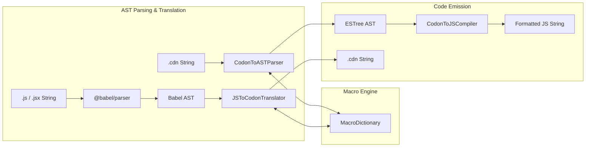

# Codon Programmatic TypeScript API

This document provides a complete developer reference for integrating Codon's parser, compiler, translator, and macro dictionary programmatically within Node.js, Bun, and TypeScript applications.

---

## Table of Contents

1. [Architecture Overview](#architecture-overview)
2. [`CodonToASTParser`](#codontoastparser)
   - [Methods](#codontoastparser-methods)
   - [Usage Example](#codontoastparser-example)
3. [`CodonToJSCompiler`](#codontojscompiler)
   - [Methods](#codontojscompiler-methods)
   - [Usage Example](#codontojscompiler-example)
4. [`JSToCodonTranslator`](#jstocodontranslator)
   - [Methods](#jstocodontranslator-methods)
   - [Usage Example](#jstocodontranslator-example)
5. [`MacroDictionary`](#macrodictionary)
   - [Methods & Properties](#macrodictionary-methods--properties)
   - [Subtree Normalization & Scope Resolution](#subtree-normalization--scope-resolution)
   - [Usage Example](#macrodictionary-example)
6. [End-to-End Programmatic Recipes](#end-to-end-programmatic-recipes)
   - [Bidirectional Roundtrip Pipeline](#bidirectional-roundtrip-pipeline)
   - [Measuring Token Savings for LLMs](#measuring-token-savings-for-llms)
   - [Custom Build Tool / Plugin Integration](#custom-build-tool--plugin-integration)

---

## Architecture Overview

Codon's core compiler pipeline is organized into three primary modules:



---

## `CodonToASTParser`

Exported from `codon-parser.ts` (also aliased as `CodonParser`). Parses Codon source code into an ESTree-compatible Abstract Syntax Tree.

### Methods

#### `parse(code: string): Program`
Parses a full multi-line Codon program, resolving top-level imports, classes, functions, and control blocks into an ESTree `Program` AST node.

#### `parseStatement(stmt: string): Node | null`
Parses a single Codon statement string (such as an `if.` block, class declaration, assignment, or statement-level macro invocation `M!name(...)`).

#### `parseExpression(expr: string): Node`
Parses an un-nested Codon expression string (including objects `O(...)`, arrays `[...]`, tacit trains `(f g h)`, monadic verbs `@`, or expression-level macro calls `M!name(...)`).

#### `parseMacroInvocation(raw: string): Node`
Parses a raw macro invocation string (`M!name(arg1;arg2)`), retrieves the template from `macroDictionary`, expands placeholders, and returns the resulting ESTree AST node.

### Usage Example

```typescript
import { CodonToASTParser } from "./codon-parser";

const parser = new CodonToASTParser();
const codonSource = `
import. { useState } from 'react'

fn. Counter initial=0 do.
  [count, setCount] =: (useState initial)
  randomIdx =: M!m_call_expr_11(items)
  return. count
end.
`;

const ast = parser.parse(codonSource);
console.log(`Parsed ${ast.body.length} top-level statements.`);
```

---

## `CodonToJSCompiler`

Exported from `transpilers.ts`. Takes an ESTree-compatible AST produced by `CodonToASTParser`, normalizes nodes, maps tacit trains and array verbs, and emits formatted JavaScript via `@babel/generator`.

### Methods

#### `transpile(ast: Program): string`
Converts the AST program into formatted, valid JavaScript.

### Usage Example

```typescript
import { CodonToASTParser } from "./codon-parser";
import { CodonToJSCompiler } from "./transpilers";

const parser = new CodonToASTParser();
const compiler = new CodonToJSCompiler();

const codonCode = `total =: +/ 10 20 30`;
const ast = parser.parse(codonCode);
const jsCode = compiler.transpile(ast);

console.log(jsCode);
// Output: const total = sum([10, 20, 30]);
```

---

## `JSToCodonTranslator`

Exported from `transpilers.ts`. Walks a modern JavaScript or JSX Babel AST and emits concise, expressive Codon notation. Automatically performs Level-2 clone recognition against `dict.json` to compact matching subtrees into `M!name(args)` calls.

### Methods

#### `transpile(node: Node | null | undefined): string`
Translates an AST node into Codon source text. When called on a `Program` node, it constructs the lexical scope graph first via `resolveScopes`.

#### `tryMacroMatch(node: Node): string | null`
Tests whether an individual AST node matches any Level-2 clone pattern in `dict.json`. Returns `M!name(args)` on match, or `null` if no match exists.

### Usage Example

```typescript
import * as babelParser from "@babel/parser";
import { JSToCodonTranslator } from "./transpilers";

const jsCode = `
import express from "express";

function getRandomItem(items) {
  return items[Math.floor(Math.random() * items.length)];
}
`;

const jsAst = babelParser.parse(jsCode, { sourceType: "module" });
const translator = new JSToCodonTranslator();
const codonCode = translator.transpile(jsAst.program as any);

console.log(codonCode);
// Output:
// import. express from 'express'
// fn. getRandomItem items do.
// return. (from (M!m_call_expr_11(items)) items)
// end.
```

---

## `MacroDictionary`

Exported as the singleton instance `macroDictionary` from `macro-dict.ts`.

### Methods & Properties

#### `load(): void`
Loads and indexes `dict.json` from disk. Automatically invoked on first access if not called explicitly.

#### `size: number`
Returns the total number of template-ready macros loaded in the dictionary (721).

#### `lookupByName(name: string): MacroEntry | undefined`
Queries a macro entry by its unique name (e.g. `"m_call_expr_11"`).

#### `lookupByHash(hash: string): MacroEntry | undefined`
Queries a macro entry by its 64-bit wyhash signature.

#### `entriesForNodeType(nodeType: string): MacroEntry[]`
Returns all registered macros for an AST node type (e.g. `"CallExpression"`, `"ObjectExpression"`).

#### `expandTemplate(macro: MacroEntry, args: string[]): string`
Expands parameter placeholders (`__clone_arg0`, `__clone_lit0`) with concrete arguments, and generates hygienic local identifiers (`_loc_0`).

#### `expandToAST(macro: MacroEntry, args: string[]): any`
Expands the template and parses the result into an ESTree AST node using Babel parser.

### Subtree Normalization & Scope Resolution

`macro-dict.ts` exports helper functions for AST hashing:

- **`resolveScopes(program: any): ScopeResolution`**: Builds the lexical scope graph tracking variable declarations and bindings.
- **`normalizeSubtree(root: any, resolution?: ScopeResolution)`**: Canonicalizes an AST node, returning `{ canonical, hash, placeholderArgs }`.

### Usage Example

```typescript
import { macroDictionary } from "./macro-dict";

// Lookup macro
const macro = macroDictionary.lookupByName("m_binary_expr_32");
if (macro) {
  console.log(`Node type: ${macro.nodeType}`); // BinaryExpression
  console.log(`Original count in repos: ${macro.count}`);

  // Expand with argument
  const code = macroDictionary.expandTemplate(macro, ["inputStr"]);
  console.log(code);
  // inputStr.charAt(0).toUpperCase() + inputStr.slice(1)
}
```

---

## End-to-End Programmatic Recipes

### Bidirectional Roundtrip Pipeline

```typescript
import * as babelParser from "@babel/parser";
import { CodonToASTParser } from "./codon-parser";
import { CodonToJSCompiler, JSToCodonTranslator } from "./transpilers";

function roundtripJS(jsSource: string): string {
  // Step 1: JS -> Codon (Translate with macro compaction)
  const babelAst = babelParser.parse(jsSource, { sourceType: "module", plugins: ["jsx"] });
  const translator = new JSToCodonTranslator();
  const codonCode = translator.transpile(babelAst.program as any);

  // Step 2: Codon -> JS (Parse and compile with macro expansion)
  const parser = new CodonToASTParser();
  const codonAst = parser.parse(codonCode);
  const compiler = new CodonToJSCompiler();
  const compiledJs = compiler.transpile(codonAst);

  return compiledJs;
}

const original = `const pick = (arr) => Math.floor(Math.random() * arr.length);`;
const result = roundtripJS(original);
console.log("Roundtripped JS:", result);
```

### Measuring Token Savings for LLMs

```typescript
import * as babelParser from "@babel/parser";
import { JSToCodonTranslator } from "./transpilers";

function estimateTokens(text: string): number {
  // Approximate standard BPE tokenizer estimation (~4 characters per token)
  return Math.ceil(text.trim().length / 4);
}

const jsCode = `
Child.prototype = Object.create(Parent.prototype);
const idx = Math.floor(Math.random() * items.length);
const capitalized = word.charAt(0).toUpperCase() + word.slice(1);
`;

const jsAst = babelParser.parse(jsCode, { sourceType: "module" });
const translator = new JSToCodonTranslator();
const codonCode = translator.transpile(jsAst.program as any);

console.log(`JS Tokens:    ~${estimateTokens(jsCode)}`);
console.log(`Codon Tokens: ~${estimateTokens(codonCode)}`);
console.log(`Estimated Token Savings: ${Math.round((1 - codonCode.length / jsCode.length) * 100)}%`);
```

### Custom Build Tool / Plugin Integration

Example Bun build plugin for loading `.cdn` files directly in a Bun application:

```typescript
import { plugin } from "bun";
import { CodonToASTParser } from "./codon-parser";
import { CodonToJSCompiler } from "./transpilers";

plugin({
  name: "codon-loader",
  setup(builder) {
    builder.onLoad({ filter: /\.cdn$/ }, async (args) => {
      const source = await Bun.file(args.path).text();
      const parser = new CodonToASTParser();
      const compiler = new CodonToJSCompiler();

      const ast = parser.parse(source);
      const contents = compiler.transpile(ast);

      return {
        contents,
        loader: "js",
      };
    });
  },
});
```
